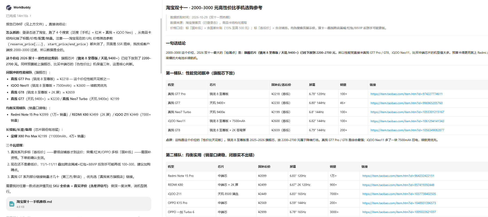
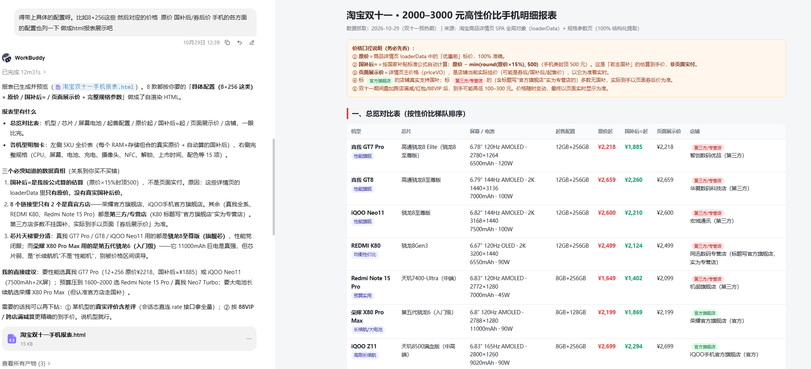
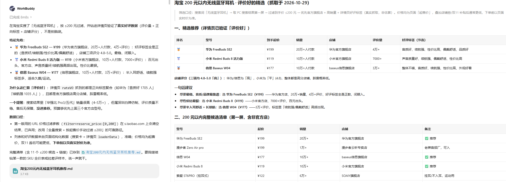
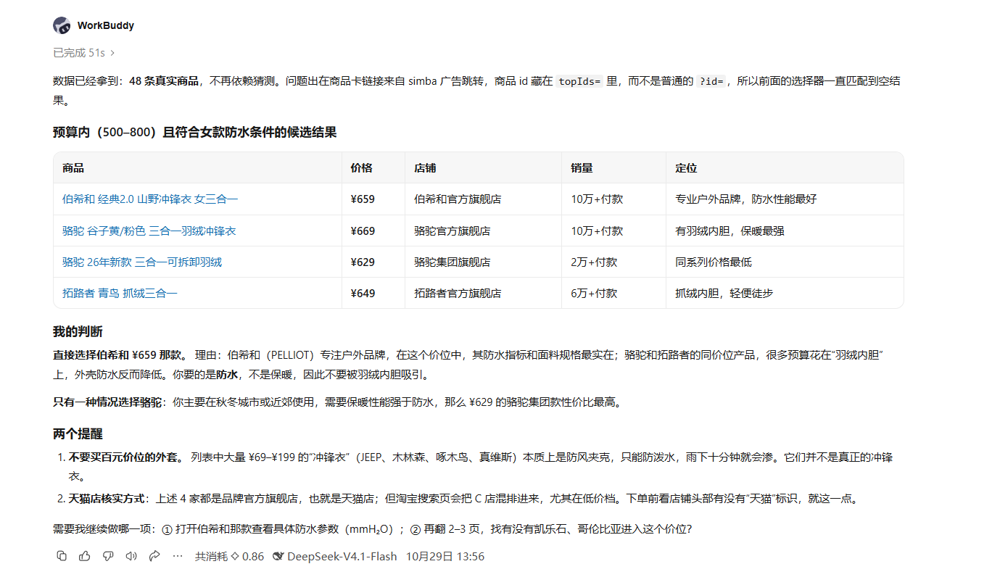
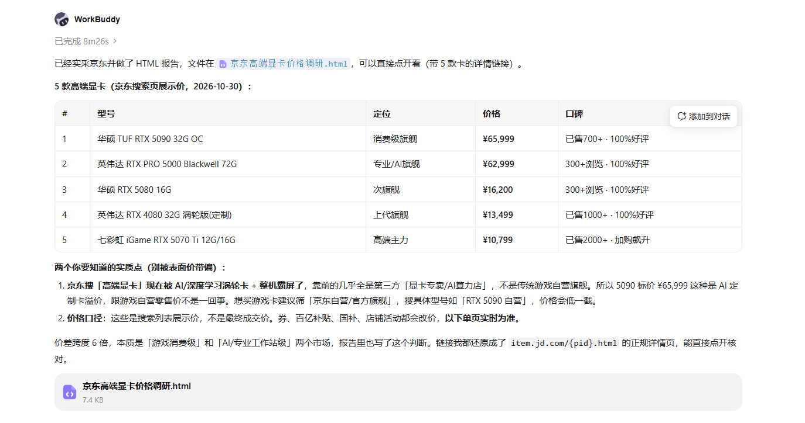
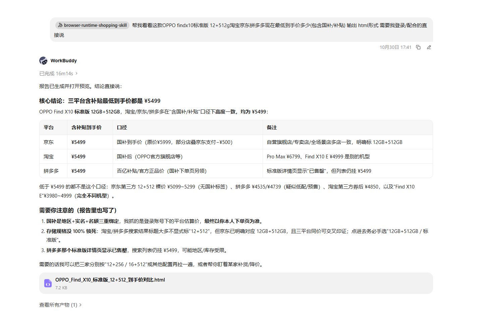

# 以下均为WorkBuddy实测
使用方法：
已在本地部署browser-runtime-mcp并且配置到WorkBuddy连接器，在WorkBuddy使用/引用技能browser-runtime-shopping-skill 后面带自然语言描述的购物需求
如：`/browser-runtime-shopping-skill 帮我看看这款OPPO findx10标准版 12+512g淘宝京东拼多多现在最低到手价多少(包含国补/补贴) 输出 html形式 需要我登录/配合的直接说`

完整产物见 [产物文档/](产物文档/)。截图为当时快照，价格以下单页为准。

示例：

问题1：帮我看下淘宝双十一2000-3000元价位高性价比的手机

问题2：帮我在淘宝搜 200 元以内的无线蓝牙耳机，挑评价好的

问题3：淘宝找一款机械键盘，要青轴 帮我算凑单之后的满减到手价，给我不同凑单方案

问题4：淘宝买登山冲锋衣，预算 500–800，要防水、女款，优先天猫店

问题5：去京东帮我看下高端显卡都什么价 找5个高端显卡给我汇报下 做个html

问题6：帮我看看这款OPPO findx10标准版 12+512g淘宝京东拼多多现在最低到手价多少(包含国补/补贴) 输出 html形式 需要我登录/配合的直接说

